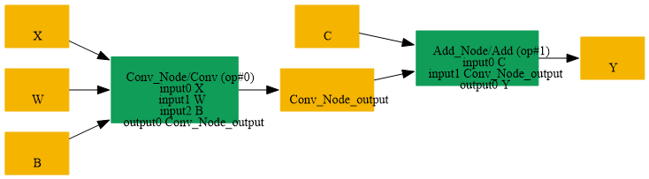
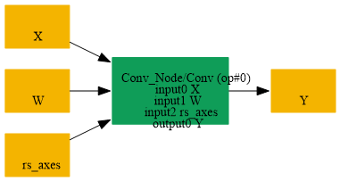

# Fuse_Add_Scalar_Into_Conv

## Introduction

### Description

Fuse Add Scalar Into Conv Operation

This transformation pattern searches for a Conv operation followed by an Add operation where the Add node adds a scalar value to the Conv output. When found, this pattern fuses these two operations by:

1. Modifying the Conv node's bias parameter by adding the scalar value
2. Removing the subsequent Add node
3. Directing the Conv output directly to the Add node's output
This optimization reduces model complexity and improves inference performance by reducing the number of operations and memory allocations.

### Preconditions

- Add node must have its second input as an initializer (constant)
- Add node's second input must be a scalar value
- Conv node must directly feed into the Add node
### Result

Single Conv operation with fused bias instead of Conv + Add Example:

- BEFORE (SearchBy):
```text
input → Conv[weights, bias] → Add[scalar] → output
```

- AFTER (ReplaceBy):
```text
input → Conv[weights, fused_bias] → output
```

## SearchBy



## ReplaceBy


