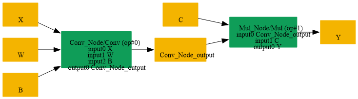

# Fuse_Mul_Scalar_Into_Conv

## Introduction

### Description

Fuse Mul Scalar Into Conv Operation

This transformation pattern searches for a Conv operation followed by a Mul operation where the Mul node multiplies the Conv output by a scalar value. When found, this pattern fuses these two operations by:

1. Scaling the Conv node's weight initializer by the scalar value
2. Scaling the Conv node's bias initializer by the scalar value if present
3. Removing the subsequent Mul node
4. Directing the Conv output directly to the Mul node's output
This optimization reduces model complexity and improves inference performance by reducing the number of operations and memory allocations.

### Preconditions

- Mul node must consume the Conv output as one input
- Mul node must have the other input as an initializer (constant)
- Mul node's initializer input must be a scalar value
- Conv node must directly feed into the Mul node
### Result

Single Conv operation with fused weight/bias instead of Conv + Mul Example:

- BEFORE (SearchBy):
```text
input → Conv[weights, bias] → Mul[scalar] → output
```

- AFTER (ReplaceBy):
```text
input → Conv[weights*scalar, bias*scalar] → output
```

## SearchBy



## ReplaceBy


