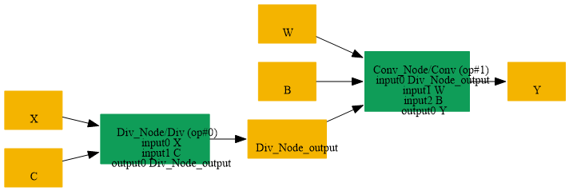
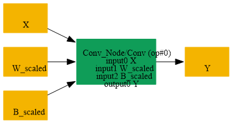

# Fuse_Parent_Div_Scalar_Into_Child_Conv

## Introduction

### Description

Fuse Parent Mul Scalar Into Child Conv Operation

This transformation pattern searches for a scalar Mul operation that feeds directly into a Conv node, where the Mul multiplies the input tensor by a constant scalar before the Conv is applied. When found, this pattern fuses the scalar multiplication into the Conv by:

1. Scaling the Conv node's weight initializer by the scalar value
2. Removing the preceding Mul node
3. Rewiring the Conv to consume the original input directly
This optimization reduces model complexity and improves inference performance by eliminating an unnecessary multiply node and reducing memory traffic.

### Preconditions

- Mul node must produce the Conv input tensor
- Mul node must have one initializer input that is a scalar value
- The scalar Mul must directly feed the Conv node
- The Conv node must use the Mul output as its first input
### Result

Single Conv operation with fused weight/bias instead of Mul + Conv Example:

- BEFORE (SearchBy):
```text
input → Mul[scalar] → Conv[weights, bias] → output
```

- AFTER (ReplaceBy):
```text
input → Conv[weights*scalar, bias] → output
```

## SearchBy



## ReplaceBy


