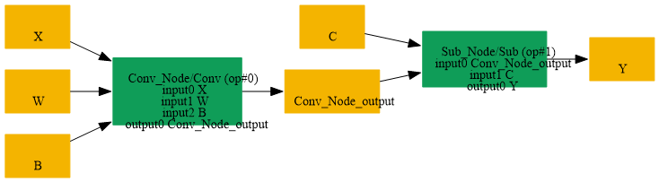

# Fuse_Sub_Scalar_Into_Conv

## Introduction

### Description

Fuse Sub Scalar Into Conv Operation

This transformation pattern searches for a Conv operation followed by a Sub operation where the Sub node subtracts a scalar value from the Conv output. When found, this pattern fuses these two operations by:

1. Modifying the Conv node's bias parameter by subtracting the scalar value
2. Removing the subsequent Sub node
3. Directing the Conv output directly to the Sub node's output
This optimization reduces model complexity and improves inference performance by reducing the number of operations and memory allocations.

### Preconditions

- Sub node must consume the Conv output as its first input
- Sub node must have its second input as an initializer (constant)
- Sub node's second input must be a scalar value
- Conv node must directly feed into the Sub node
### Result

Single Conv operation with fused bias instead of Conv + Sub Example:

- BEFORE (SearchBy):
```text
input → Conv[weights, bias] → Sub[scalar] → output
```

- AFTER (ReplaceBy):
```text
input → Conv[weights, fused_bias] → output
```

## SearchBy



## ReplaceBy


