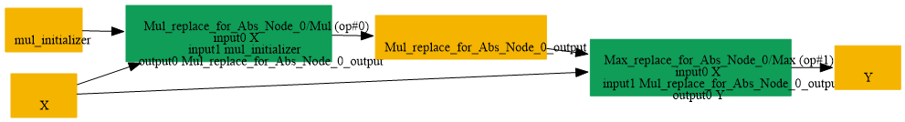

# Replace_Abs_By_Mul_Max

## Introduction

### Description

Replace Abs with Max and Mul operations

This transformation pattern replaces an Abs operation with an equivalent **computation using two basic operations:** Mul and Max.

### Mathematical Equivalence

Abs(x) = Max(x, -x)

### Transformation Steps

1. Create a negation of the original input using Mul with -1
2. Compare the original input and the negated input using Max
3. Remove the original Abs node
### Benefits

- Enables backends that may not support Abs to use basic arithmetic operations
- Supports decomposition for hardware with limited Abs support
- Preserves semantic equivalence of the original Abs operation
### Preconditions

- Input tensor must be compatible with elementwise Mul and Max
### Example

**Input:** x = [1.0, -2.0, 0.5] Original Abs computation:

```text
Abs(x) = [1.0, 2.0, 0.5]
```

Decomposed computation:

```text
Mul:        neg_x = x * -1 = [-1.0, 2.0, -0.5]
Max:        output = Max(x, neg_x) = [1.0, 2.0, 0.5]
```

**Result:** Equivalent output preserved by Mul and Max operations

### Result

Equivalent computation using atomic operations instead of Abs

## SearchBy


## ReplaceBy


