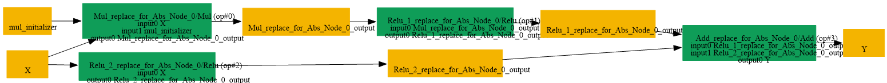

# Replace_Abs_By_Mul_Relu_Add

## Introduction

### Description

Replace Abs with Mul + Relu + Add operations

This transformation pattern replaces an Abs operation with an equivalent **computation using three basic operations:** Mul, Relu, and Add.

### Mathematical Equivalence

Abs(x) = Relu(x) + Relu(-x)

### Transformation Steps

1. Create a negation of the original input using Mul with -1
2. Apply Relu to the negated input
3. Apply Relu to the original input
4. Add the two Relu results together
5. Remove the original Abs node
### Benefits

- Enables backends that may not support Abs to use basic arithmetic operations
- Supports decomposition for hardware with limited Abs support
- Preserves semantic equivalence of the original Abs operation
### Preconditions

- Input tensor must be compatible with elementwise Mul, Relu, and Add
### Example

**Input:** x = [1.0, -2.0, 0.5] Original Abs computation:

```text
Abs(x) = [1.0, 2.0, 0.5]
```

Decomposed computation:

```text
Mul:        neg_x = x * -1 = [-1.0, 2.0, -0.5]
Relu(neg_x)= [0.0, 2.0, 0.0]
Relu(x):    [1.0, 0.0, 0.5]
Add:        output = [1.0, 2.0, 0.5]
```

**Result:** Equivalent output preserved by Mul, Relu, and Add operations

### Result

Equivalent computation using atomic operations instead of Abs

## SearchBy


## ReplaceBy


