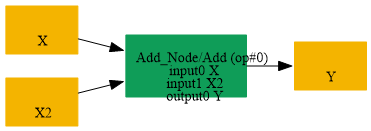

# Replace_Add_Initializer_Unique_By_Conv

## Introduction

### Description

Replace Add Initializer Unique By Conv Operation

This transformation pattern replaces an Add operation where one input is an initializer with unique values across width and height dimensions by an equivalent Conv operation. It expresses the same elementwise addition semantics through a convolution primitive that uses identity-like weights and a bias tensor derived from the initializer.

### Equivalence

Add(X, I) = Conv(X, W, b) when I is a constant initializer that can be represented as a broadcastable bias over the convolution output channels.

### Transformation Steps

1. Detect an Add node whose one input is an initializer and the other input
```text
is a tensor value.
```

2. Verify the initializer contains unique values in its spatial dimensions
```text
using CheckUniqueValuesInWidthHeight.
```

3. Create a Conv weight tensor W with shape [C, C, 1, 1, ..., 1] and values
```text
that preserve the input tensor channels.
```

4. Create a bias initializer b from the unique initializer values.
5. Replace the Add node with a Conv node that consumes the original tensor
```text
input, W, and b.
```

6. Remove the original Add node while preserving the Add output tensor.
### Benefits

- Expresses the Add operation using a standard convolution primitive.
- Improves compatibility with backends that prefer Conv-based graphs.
- Preserves the original computation while enabling uniform graph
```text
transformations.
```

### Preconditions

- One input of the Add node must be an initializer constant.
- The initializer must have unique spatial values in width and height.
- The non-initializer input must be compatible with Conv semantics.
### Example

Original graph:

```text
X ----> Add ----> Y
^
|
I (initializer with unique width/height values)
```

Replacement graph:

```text
X ----> Conv(W=identity_kernel, b=converted_initializer) ----> Y
```

In this example, the Conv uses an identity-like weight tensor W and a bias tensor b built from the unique initializer values so that the output remains the same as the original Add operation.

### Result

A Conv-based replacement that preserves the Add semantics

## SearchBy



## ReplaceBy


