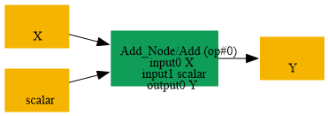
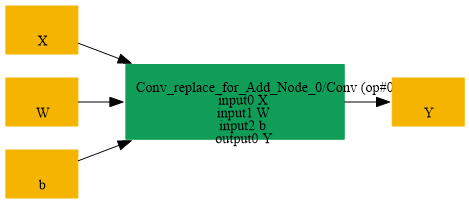

# Replace_Add_Scalar_Initializer_By_Conv

## Introduction

### Description

Replace Add Scalar Initializer by Conv Operation

This transformation pattern replaces an Add operation that adds a scalar initializer to an N-D tensor by an equivalent Conv operation. The Conv uses an identity kernel with spatial kernel shape [1, 1, ..., 1] and a bias tensor derived from the scalar initializer, preserving the original elementwise addition semantics while expressing it through a convolution primitive.

### Mathematical Equivalence

Add(X, s) = Conv(X, W, b) where W is an identity kernel of shape [C, C, 1, 1, ..., 1] and b is the scalar value broadcasted across output channels.

### Transformation Steps

1. Find an Add node with one input as a scalar initializer and the other input as a tensor of rank >= 3.
2. Remove the scalar initializer from the Add node.
3. Create an identity Conv weight tensor W of shape [C, C, 1, 1, ..., 1], where C is the number of channels.
4. Create a bias initializer b by tiling the scalar across the output channels.
5. Insert a Conv node that consumes the original tensor input, W, and b.
6. Remove the original Add node and preserve the same output tensor.
### Benefits

- Expresses scalar addition using a standard convolution primitive.
- Improves compatibility with backends that prefer Conv-based graph representations.
- Enables uniform handling of bias addition in graph transformation passes.
### Preconditions

- The Add node must have one input that is a scalar initializer.
- The other Add input must be a tensor with shape [N, C, ...] that is compatible with Conv semantics.
- The scalar must be broadcastable to the Conv bias shape.
### Example

**Input tensor:** X with shape [N, C, H, W] **Scalar initializer:** s = 3.0 Original graph:

```text
X ----> Add ----> Y
^
|
s
```

Equivalent replacement:

```text
X ----> Conv(W=I_C, b=tile([s], C)) ----> Y
```

where W is an identity kernel of shape [C, C, 1, 1] and b is a bias vector created by replicating the scalar initializer across C output channels.

### Result

A Conv-based replacement that preserves the original Add semantics

## SearchBy



## ReplaceBy


