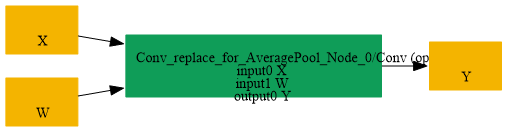

# Replace_AveragePool_By_Conv

## Introduction

### Description

Replace AveragePool by Conv operation

This transformation pattern replaces an AveragePool node with an equivalent Conv node that uses a uniform kernel and no bias, preserving the average pooling semantics for simple 2D average pooling cases.

### Mathematical Equivalence

AveragePool(X) = Conv(X, W, b=0) where W contains equal weights over the pool window and b is zero.

### Transformation Steps

1. Detect an AveragePool node with a kernel_shape attribute.
2. Create a Conv weight initializer filled with uniform values.
3. Replace the AveragePool node with a Conv node using the new weights.
4. Remove the original AveragePool node.
### Benefits

- Enables backend support for Conv-based average pooling.
- Preserves pooling semantics in a standard convolution form.
- Simplifies lowering to backends that prefer Conv primitives.
### Preconditions

- The AveragePool node must have a kernel_shape attribute.
- The transformation targets the simple average-pooling case with no extra padding semantics.
### Result

An equivalent Conv node replaces the AveragePool operation

## SearchBy

## ReplaceBy

