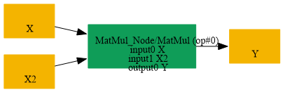
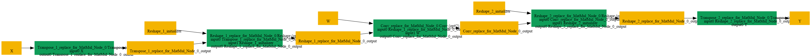

# Replace_BatchMatMul_By_Conv

## Introduction

### Description

Replace BatchMatMul by Conv operation

This transformation pattern rewrites a BatchMatMul node whose second input can be viewed as a convolutional weight tensor into an equivalent Conv operation. The goal is to preserve the original matrix multiplication result while expressing the same computation in a form that is easier to handle with backends, graph optimizers, or Conv-first lowering pipelines.

### Mathematical Equivalence

A batched matrix multiplication can be converted into a convolution by reordering the tensor axes, reshaping the data into channel-first spatial layouts, and reconstructing the original weight tensor as a convolution kernel. After the Conv is applied, the output is rearranged back to the expected batch-matrix layout so the semantics remain unchanged.

### Transformation Steps

1. Detect a MatMul or BatchMatMul pattern where the second operand is
```text
compatible with a convolutional kernel layout.
```

2. Transpose the first input so the multiply dimension is positioned in a
```text
way that matches the Conv channel/spatial arrangement.
```

3. Reshape the tensor into the form expected by the kernel application.
4. Reshape the second input into a Conv-style filter tensor, such as
```text
[C_out, C_in, 1, 1] for the 1x1 case or the analogous grouped layout.
```

5. Replace the BatchMatMul node with a Conv node that applies the new
```text
filter to the transformed input tensor.
```

6. Restore the final output layout using a Reshape/Transpose pair and
```text
remove the original BatchMatMul node.
```

### Benefits

- Converts a matrix multiplication to a standard Conv primitive.
- Improves compatibility with graph implementations that prefer Conv.
- Keeps the execution mathematically equivalent while normalizing the
```text
representation for downstream optimization passes.
```

### Preconditions

- The second input must be compatible with the weight reshaping rules.
- The matrix multiplication must match the kernel layout used by the
```text
rewritten convolution form.
```

- The output tensor shape must be restored after the Conv to preserve the
```text
original BatchMatMul result.
```

### Example

Original computation:

### X

[B, M, K]

### W

[K, 1]  (or an equivalent batched matrix form)

```text
Y = BatchMatMul(X, W)
```

Equivalent Conv-style flow:

```text
X --Transpose--> Reshape --> Conv(W') --> Reshape --> Transpose --> Y
```

In this example, the input tensor is rearranged so the matrix multiply acts like a per-channel convolution over the effective spatial dimension. The weight matrix W is reshaped into a filter tensor W' with the same values, but in a shape that Conv expects. After the convolution, the output is reshaped and transposed back to the original BatchMatMul output layout, so the final tensor matches the original result exactly.

### Result

A Conv-based replacement that preserves the original BatchMatMul semantics

## SearchBy



## ReplaceBy


