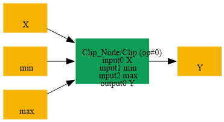
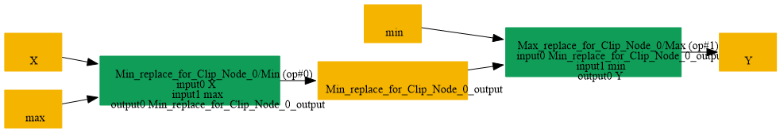

# Replace_Clip_By_Min_Max

## Introduction

### Description

Replace Clip with Min and Max operations

This transformation decomposes a Clip node with both minimum and **maximum inputs into two elementary operations:** Min followed by Max. The intermediate Min output is connected to the Max input, and the final Max output keeps the original Clip output name.

### Match Condition

- The node operator is Clip
- The Clip data input is {node.input[0]}
- The minimum input is {node.input[1]}
- The maximum input is {node.input[2]}
### Mathematical Equivalence

Clip(x, min, max) = Max(Min(x, max), min) The bounds must satisfy min <= max for the usual clipping behavior.

### Transformation Steps

1. Find a Clip node with data, minimum, and maximum inputs
2. Remove the original Clip node
3. Create a Min node using the data input and maximum input
4. Store the Min result in an intermediate tensor
5. Create a Max node using the intermediate tensor and minimum input
6. Reuse the original Clip output name for the final Max output
### Example

**Original graph:** Clip(input, min_value, max_value) input = [-2.0, 0.5, 4.0], min_value = 0.0, max_value = 1.5 **Original output:** Clip(input, 0.0, 1.5) = [0.0, 0.5, 1.5] Replacement graph:

```text
1. Min(input, max_value) = Min([-2.0, 0.5, 4.0], 1.5)
= [-2.0, 0.5, 1.5]
2. Max(min_result, min_value) = Max([-2.0, 0.5, 1.5], 0.0)
= [0.0, 0.5, 1.5]
```

### Result

Equivalent computation using Min followed by Max

## SearchBy



## ReplaceBy


