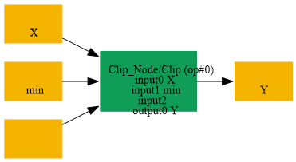
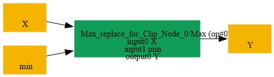

# Replace_Clip_NoneMax_By_Max

## Introduction

### Description

Replace Clip with no maximum value by a Max operation

This transformation finds a Clip node whose maximum input is omitted and whose minimum input is provided. It replaces the Clip node with an equivalent Max operation while preserving the original output name.

### Match Condition

- The node operator is Clip
- The minimum input is present
- The maximum input is empty
### Mathematical Equivalence

Clip(x, min, None) = Max(x, min)

### Transformation Steps

1. Find a Clip node with a minimum input and no maximum input
2. Remove the original Clip node
3. Create a Max node using the Clip data input and minimum input
4. Reuse the original Clip output name for the Max output
### Example

**Original graph:** Clip(input, min_value, None) input = [-2.0, 0.5, 4.0] and min_value = 1.0 **Original output:** Clip(input, 1.0, None) = [1.0, 1.0, 4.0] **Replacement graph:** Max(input, min_value) **Replacement output:** Max([-2.0, 0.5, 4.0], 1.0) = [1.0, 1.0, 4.0]

### Result

Equivalent computation using Max instead of Clip

## SearchBy

## ReplaceBy

