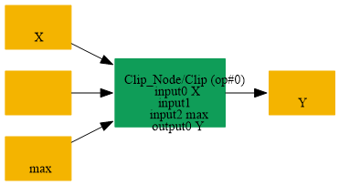
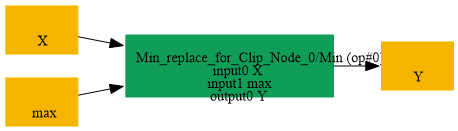

# Replace_Clip_NoneMin_By_Min

## Introduction

### Description

Replace Clip with no minimum value by a Min operation

This transformation finds a Clip node whose minimum input is omitted and whose maximum input is provided. It replaces the Clip node with an equivalent Min operation while preserving the original output name.

### Match Condition

- The node operator is Clip
- The minimum input is empty
- The maximum input is present
### Mathematical Equivalence

Clip(x, None, max) = Min(x, max)

### Transformation Steps

1. Find a Clip node with no minimum input and a maximum input
2. Remove the original Clip node
3. Create a Min node using the Clip data input and maximum input
4. Reuse the original Clip output name for the Min output
### Example

**Original graph:** Clip(input, None, max_value) input = [-2.0, 0.5, 4.0] and max_value = 1.5 **Original output:** Clip(input, None, 1.5) = [-2.0, 0.5, 1.5] **Replacement graph:** Min(input, max_value) **Replacement output:** Min([-2.0, 0.5, 4.0], 1.5) = [-2.0, 0.5, 1.5]

### Result

Equivalent computation using Min instead of Clip

## SearchBy

## ReplaceBy

