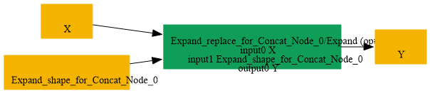

# Replace_Concat_SameInput_By_Expand

## Introduction

### Description

Replace Concat with identical inputs by Expand operation

This transformation pattern replaces a Concat node that concatenates the same input tensor multiple times with an equivalent Expand node that repeats the tensor along the specified axis.

### Mathematical Equivalence

Concat([X, X, ..., X (n times)], axis=k) = Expand(X, new_shape) where new_shape increases the dimension at axis k by a factor of n.

### Transformation Steps

1. Detect a Concat node where all inputs reference the same tensor.
2. Calculate the repetition count (number of identical inputs).
3. Compute the new shape by multiplying the dimension at the concat axis
```text
by the repetition count.
```

4. Create an Expand node with the computed shape as an initializer.
5. Replace the Concat node with the Expand node.
6. Remove the original Concat node.
### Benefits

- Reduces redundant tensor memory references in the graph.
- Enables backends optimized for Expand operations.
- Simplifies dataflow and improves memory efficiency.
- Canonical form for repeated concatenation patterns.
### Preconditions

- The Concat node must have multiple inputs that all reference the same tensor.
- The axis attribute must be present and valid for the input tensor rank.
- The input tensor shape must be known or inferrable.
### Result

An equivalent Expand node replaces the Concat operation

## SearchBy


## ReplaceBy


