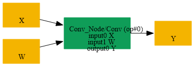

# Replace_Conv_By_AveragePool

## Introduction

### Description

Replace Conv with uniform weights by AveragePool operation

This transformation pattern restores an AveragePool node from a Conv node whose weights are uniform and whose behavior is equivalent to average pooling.

### Mathematical Equivalence

AveragePool(X) = Conv(X, W, b=0) where W contains equal weights over the pool window and b is zero.

### Transformation Steps

1. Detect a Conv node whose weight initializer is uniform.
2. Replace the Conv node with an AveragePool node using the same kernel shape.
3. Remove the temporary Conv weight initializer.
### Benefits

- Restores the original AveragePool representation.
- Simplifies the graph and improves readability.
- Preserves the equivalent average-pooling semantics.
### Preconditions

- The Conv node must use a uniform initializer as its weight tensor.
- The Conv node must be equivalent to a simple average-pooling window.
### Result

An equivalent AveragePool node replaces the Conv operation

## SearchBy

## ReplaceBy

