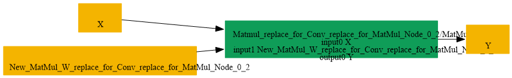

# Replace_Conv_By_BatchMatMul

## Introduction

### Description

Replace Conv by BatchMatMul operation

This transformation pattern rewrites a Conv node with compatible dimensions into an equivalent BatchMatMul operation. The goal is to preserve the original convolution result while expressing the same computation as a batched matrix multiplication, which can be more efficient for certain backends or enable fusion with subsequent matrix operations.

### Mathematical Equivalence

A convolution operation can be converted into a batched matrix multiplication by reordering the tensor axes, reshaping the data from channel-spatial layouts into batch-matrix layouts, and reconstructing the convolution kernel as a weight matrix. After the BatchMatMul is applied, the output is rearranged back to the expected convolutional output layout so the semantics remain unchanged.

### Transformation Steps

1. Detect a Conv pattern where the kernel dimensions are compatible with a
```text
matrix multiplication layout (e.g., [C_out, C_in, 1, 1] for 1x1 Conv).
```

2. Transpose the input tensor so that the channel and spatial dimensions align
```text
with the matrix multiplication operand format.
```

3. Reshape the input tensor into a 3D batch-matrix form [B, M, K] where B is
```text
batch, M is the multiply dimension, and K is the contraction dimension.
```

4. Reshape the convolution filter into a 2D weight matrix compatible with the
```text
matrix multiplication layout [K, N].
```

5. Replace the Conv node with a BatchMatMul node that performs the equivalent
```text
matrix multiplication operation.
```

6. Restore the final output layout using a Reshape/Transpose pair to match the
```text
expected convolution output dimensions and remove the original Conv node.
```

### Benefits

- Converts a convolution operation to a standard matrix multiplication.
- Improves compatibility with backends that prefer BatchMatMul primitives.
- Enables fusion opportunities with subsequent matrix operations.
- Keeps the execution mathematically equivalent while normalizing the
```text
representation for downstream optimization passes.
```

### Preconditions

- The convolution kernel must have spatial dimensions of 1x1 or be compatible
```text
with the matrix multiplication weight reshaping rules.
```

- The convolution attributes (group, pad, stride) must be compatible with a
```text
direct matrix multiplication interpretation.
```

- The output tensor shape must be restored after the BatchMatMul to preserve
```text
the original Conv result.
```

### Example

Original computation:

```text
Input X: [B, C_in, H, W]
Filter W: [C_out, C_in, 1, 1]
Output Y: Conv(X, W) = [B, C_out, H, W]
```

Transformed computation:

```text
Transpose X to [B, H, W, C_in]
Reshape X to [B*H*W, C_in]
Reshape W to [C_in, C_out]
Compute Y_mm = BatchMatMul([B*H*W, C_in], [C_in, C_out]) = [B*H*W, C_out]
Reshape Y_mm to [B, H, W, C_out]
Transpose to [B, C_out, H, W]
```

Both paths produce identical results, enabling the use of matrix multiplication primitives in place of convolution operations.

## SearchBy


## ReplaceBy


