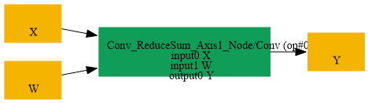
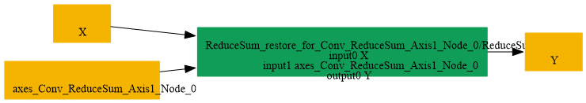

# Replace_Conv_By_ReduceSum_Axis1

## Introduction

### Description

Replace Conv by ReduceSum axis=1 operation

This transformation pattern restores a channel-wise ReduceSum from a Conv node that performs a sum across the input channels using a ones-weight 1x1 kernel. It is the reverse of the ReduceSum-by-Conv transformation and is useful when a graph should be represented with a direct reduction rather than a convolution primitive.

### Mathematical Equivalence

Conv(X, W=ones([1, C, 1, 1]), b=0) = ReduceSum(X, axes=[1], keepdims=1) where each output channel sums all input channels at the same spatial location.

### Transformation Steps

1. Detect a Conv node that uses a 1x1 kernel with all ones.
2. Ensure the weight has one output channel and matches the input channel count.
3. Replace the Conv node with a ReduceSum node over axis 1.
4. Remove the temporary convolution weight initializer.
### Benefits

- Restores a clearer ReduceSum representation from Conv.
- Preserves the original channel-reduction semantics.
- Simplifies the graph for backends or passes that prefer reduction operations.
### Preconditions

- The Conv node must use a ones-filled 1x1 weight tensor.
- The Conv must have zero bias or equivalent bias-free semantics.
- The reduction is along the channel axis (axis=1) with keepdims enabled.
### Example

**Input tensor:** X with shape [N, C, H, W] **Conv weights:** W = ones([1, C, 1, 1]) Original graph:

```text
X -> Conv(X, W, b=0) -> Y
```

Restored graph:

```text
Y = ReduceSum(X, axes=[1], keepdims=1)
```

### Result

A ReduceSum node replaces the equivalent Conv-based channel reduction

## SearchBy



## ReplaceBy


