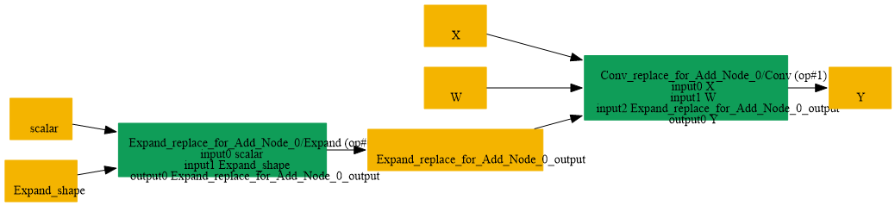
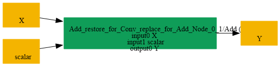

# Replace_Conv_Expand_By_Add_Scalar

## Introduction

### Description

Replace Conv with Expand bias by Add Scalar operation

This transformation pattern restores an Add operation from a Conv node that uses a scalar initializer expanded into a bias tensor via Expand. It recognizes the reverse form of Replace_Add_Scalar_By_Conv.json and replaces it with a simpler Add node that directly applies the original scalar to the tensor input.

### Mathematical Equivalence

Conv(X, W=I, Expand(s, shape=[C])) = X + s where W is an identity kernel with shape [C, C, 1, 1, ..., 1] and the Expand bias tensor is built from the scalar initializer.

### Transformation Steps

1. Detect a Conv node whose bias input is produced by an Expand node.
2. Ensure the Expand node receives a scalar initializer and a shape initializer.
3. Replace the Conv and Expand nodes with an Add node that reuses the scalar initializer.
4. Remove the temporary Conv weights and shape initializers.
### Benefits

- Restores the original Add scalar semantics in the graph.
- Simplifies the graph by removing a Conv/Expand decomposition.
- Improves readability and enables backends that prefer Add over Conv-based bias expansion.
### Preconditions

- The Conv node must consume a bias tensor produced by an Expand node.
- The Expand node must receive one scalar initializer and one shape initializer.
- The scalar initializer must be broadcastable to the Conv bias shape.
### Result

A direct Add node replaces the equivalent Conv + Expand decomposition

### Example

**Input tensor:** X with shape [N, C, H, W] **Scalar initializer:** s = 3.0 **Expanded bias:** Expand(s, shape=[C, 1, 1]) -> bias tensor of shape [C, 1, 1] **Conv weights:** W = I_C with shape [C, C, 1, 1] Original graph:

```text
X -> Conv(X, W, Expand(s, shape=[C,1,1])) -> Y
```

Restored graph:

```text
X -> Add(X, s) -> Y
```

## SearchBy



## ReplaceBy


