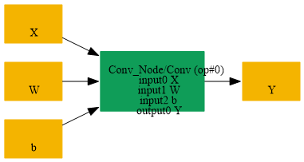
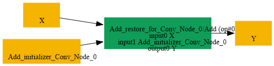

# Replace_Conv_IdentityWeight_By_Add_Initializer

## Introduction

### Description

Replace Conv with identity weights and unique bias by Add initializer

This transformation restores an Add operation from a Conv node that uses identity weights and a bias initializer with distinct channel values. It reverses the Replace_Add_Initializer_Unique_By_Conv decomposition by turning the Conv into an Add node that consumes the original tensor input and a new initializer that carries the bias values.

### Mathematical Equivalence

Conv(X, W=I_C, b) = X + b where W is an identity kernel with shape [C, C, 1, 1, ..., 1] and b is a bias initializer that encodes the distinct per-channel values.

### Transformation Steps

1. Detect a Conv node whose weight initializer is an identity kernel.
2. Ensure the Conv also has a bias initializer.
3. Replace the Conv with an Add node that consumes the original tensor input
```text
and a new initializer carrying the bias values.
```

4. Remove the original Conv weights and bias initializer.
### Benefits

- Restores the Add representation of the original initializer-based pattern.
- Simplifies the graph by removing the Conv-based decomposition.
- Preserves the original per-channel bias semantics.
### Preconditions

- The Conv node must use an identity weight initializer.
- The Conv node must have a bias initializer.
- The first Conv input must be the tensor operand.
### Result

An equivalent Add node replaces the Conv with an initializer bias

## SearchBy



## ReplaceBy


