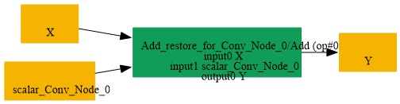

# Replace_Conv_IdentityWeight_UniqueBias_By_Add_Scalar

## Introduction

### Description

Replace Conv with identity weights and constant bias by Add Scalar operation

This transformation pattern restores an Add operation from a Conv node that uses an identity weight initializer and a constant bias initializer that is equivalent to a tiled scalar value across the output channels.

### Mathematical Equivalence

Conv(X, W=I_C, b=tile([s], C)) = X + s where W is an identity kernel of shape [C, C, 1, 1, ..., 1] and b is a bias vector with the same repeated scalar value for every output channel.

### Transformation Steps

1. Detect a Conv node whose weight initializer is an identity kernel and whose
```text
bias initializer contains the same scalar repeated across channels.
```

2. Create a scalar initializer from the repeated bias value.
3. Replace the Conv node with an Add node consuming the original tensor input
```text
and the recovered scalar initializer.
```

4. Remove the Conv weights and the expanded bias initializer.
### Benefits

- Restores the original scalar Add representation.
- Simplifies the graph by removing a Conv-based bias expansion.
- Improves readability and enables backends that prefer Add over Conv semantics.
### Preconditions

- The Conv node must use an identity weight initializer W.
- The Conv node must have a bias initializer b that is constant across output channels.
- The first Conv input must be the tensor operand, not an initializer.
### Example

**Input tensor:** X with shape [N, C, H, W] **Identity weights:** W of shape [C, C, 1, 1] **Bias initializer:** b = [s, s, ..., s] with length C Original graph:

```text
X -> Conv(X, W, b) -> Y
```

Restored graph:

```text
X -> Add(X, s) -> Y
```

### Result

Equivalent Add node replaces the Conv with identity bias expansion

## SearchBy


## ReplaceBy


