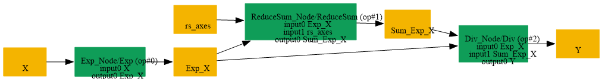

# Replace_Exp_RS_Div_By_Softmax

## Introduction

### Description

Replace Exp + ReduceSum + Div decomposition with Softmax operation

This transformation pattern searches for a Softmax decomposition implemented as Exp, ReduceSum, and Div, then replaces it with a single Softmax operation.

### Mathematical Equivalence

Softmax(x, axis=k) = Exp(x) / ReduceSum(Exp(x), axis=k)

### Transformation Steps

1. Detect an Exp node on the original input
2. Detect a ReduceSum node applied to the Exp output along a scalar axis initializer
3. Detect a Div node that divides the Exp output by the ReduceSum output
4. Replace the full decomposition with a single Softmax node
### Benefits

- Simplifies the graph by restoring the original Softmax operation
- Reduces node count and improves readability
- Enables backend support for fused Softmax kernels
### Preconditions

- The ReduceSum node must reduce the Exp output along a scalar axis initializer
- The Div node must divide Exp(x) by the ReduceSum result
### Example

**Input:** x = [1.0, 2.0, 3.0], axis=1 Decomposed computation:

```text
Exp:       exp_result = [e^1, e^2, e^3]
ReduceSum: sum_result = e^1 + e^2 + e^3
Div:       output = exp_result / sum_result
```

Restored Softmax computation:

```text
Softmax(x, axis=1)
```

### Result

Equivalent Softmax node replaces the Exp + ReduceSum + Div decomposition

## SearchBy



## ReplaceBy


