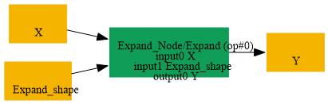
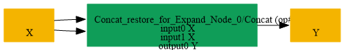

# Replace_Expand_By_Concat_SameInput

## Introduction

### Description

Replace Expand with Concat of identical inputs

This transformation reverses the two-input form of Replace_Concat_SameInput_By_Expand.json. It replaces an Expand node whose shape initializer has one expanded dimension with a Concat node that concatenates the original input twice along that dimension.

### Mathematical Equivalence

Expand(X, shape) = Concat([X, X], axis=k) for a two-times expansion where k is the dimension whose target shape is greater than one.

### Preconditions

- The node must be an Expand operation.
- The Expand shape must be an initializer.
- The generated shape must contain exactly one value greater than one.
- This pattern restores the two-input form of the original Concat.
### Result

A Concat node with two identical inputs replaces the Expand node

## SearchBy

## ReplaceBy

