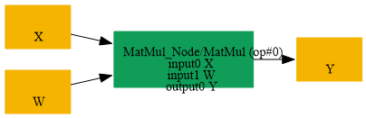
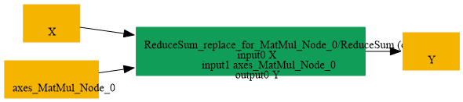

# Replace_MatMul_By_ReduceSum_LastAxis

## Introduction

### Description

Replace MatMul by ReduceSum over the last axis

This transformation pattern rewrites a MatMul node that multiplies a matrix by a ones-filled column vector into an equivalent ReduceSum along the last axis. It is the inverse of the ReduceSum-to-MatMul conversion and is useful when the graph should be expressed in a more explicit reduction form.

### Mathematical Equivalence

For a tensor X with shape [..., C] and a constant weight W = ones([C, 1]), MatMul(X, W) = ReduceSum(X, axes=[-1], keepdims=1). Each output element is the sum of the corresponding row across the last dimension, preserving the same result.

### Transformation Steps

1. Detect a MatMul where the right-hand operand is a constant ones column vector.
2. Ensure the last dimension of the left operand matches the weight size.
3. Replace MatMul with ReduceSum along the final axis, keepdims=1.
4. Remove the temporary constant weight initializer and the original MatMul node.
### Benefits

- Restores a more explicit reduction form from a matrix multiplication.
- Preserves the numerical semantics of the original last-axis aggregation.
- Helps optimize or simplify graphs that prefer reduction primitives.
### Preconditions

- The second MatMul input must be a constant initializer.
- The weight must have shape [C, 1] or otherwise represent a ones column vector.
- The reduction is over the final dimension with keepdims enabled.
### Example

**Input tensor:** X with shape [N, C] Original graph:

```text
W = ones([C, 1])
Y = MatMul(X, W)
```

Restored graph:

```text
Y = ReduceSum(X, axes=[-1], keepdims=1)
```

### Result

A ReduceSum node replaces the equivalent MatMul-based last-axis reduction

## SearchBy



## ReplaceBy


