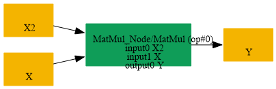

# Replace_MatMul_InitializerAt0_By_InitializerAt1

## Introduction

### Description

Replace MatMul with Initializer at First Input by Initializer

```text
at Second Input using Transpose Operations
```

This transformation pattern rewrites a MatMul node where the first input is an initializer (constant weight matrix) to an equivalent form where the initializer is positioned as the second input. The goal is to enable downstream optimizations that prefer weight matrices in the right operand position, such as Conv fusion patterns, GEMM kernel selection, and quantization-aware optimizations.

### Mathematical Equivalence

The transformation exploits the fundamental linear algebra property:

```text
(A @ B)^T = B^T @ A^T  (where @ denotes matrix multiplication, ^T denotes transpose)
```

By applying transposes strategically, we can swap the positions of the operands while maintaining numerical equivalence. The left operand (initializer) becomes the right operand, and the right operand (input) becomes the left operand. A final transpose restores the output to its original form.

### Transformation Steps

1. Identify a MatMul node where the first input is an initializer tensor.
2. Create a new initializer by transposing the first input initializer,
```text
swapping the last two dimensions using the permutation order.
```

3. Insert a Transpose node on the second input to swap its last two dimensions.
4. Replace the original MatMul with a new MatMul that uses the transposed
```text
inputs (transposed second input, new transposed initializer).
```

5. Insert a final Transpose node on the MatMul output to restore the
```text
original output shape by swapping the last two dimensions back.
```

6. Remove the original MatMul node and the original initializer from the graph.
### Benefits

- Positions initializers as the right operand, compatible with optimized
```text
GEMM implementations and BLAS-level operations.
```

- Enables fusion with downstream Conv operations that expect weights on
```text
the right side of multiplication.
```

- Improves quantization compatibility by aligning with standard
```text
per-channel quantization patterns used in production inference engines.
```

- Allows graph optimizers to apply patterns that specifically target
```text
weight-on-right MatMul operations.
```

### Preconditions

- The first input must be an initializer (constant tensor).
- The second input must be a compatible dynamic tensor.
- The MatMul operation must support transposition of its operands
```text
(i.e., both inputs and outputs must be transposable for this equivalence).
```

### Example 1

Simple Matrix Multiplication Original computation:

```text
Weight (Initializer): W [64 × 128]
Input (Dynamic):      X [batch × 128]
Original:  Y = MatMul(W[64×128], X[batch×128]) -> Output [batch × 64]
(incorrect left multiplication order)
```

After transformation:

```text
W_transposed (new Initializer): [128 × 64]  (W^T)
X_transposed (Transpose node):  [128 × batch]
MatMul:     MatMul(X_transposed[128×batch], W_transposed[128×64])
-> [batch × 64]
Final Transpose: [batch × 64] -> [batch × 64]
Output: Y [batch × 64] (numerically identical to original)
```

### Example 2

Feature Transformation in Neural Network Original computation:

```text
Weight (Initializer): kernel [256 × 512]  (output_dim × input_dim)
Input (Dynamic):      features [32 × 512]  (batch × input_dim)
Y = MatMul(kernel, features^T) -> [256 × 32] -> transpose to [32 × 256]
```

After transformation:

```text
kernel_T (new Initializer):  [512 × 256]
features_transposed (node):  [512 × 32]
MatMul output:               [512 × 256] @ no wait, shapes mismatch
Correct: MatMul([512×32], [512×256]) needs adjustment...
```

**Simplified EXAMPLE 2:** Batch Processing Original computation:

```text
Weight (Initializer): W [128 × 256]
Input (Dynamic):      data [8 × 256]  (batch_size=8)
Y = MatMul(W, data^T) is NOT the pattern, instead:
Y = MatMul(W, data) where W is left operand
Output shape considerations vary based on broadcasting rules.
```

After applying this transformation:

```text
The original left-operand initializer W[128×256] becomes right-operand.
Transposes handle the dimensional swaps automatically.
Result is numerically equivalent, optimizable for inference engines.
```

### Example 3

Impact on Quantization Original (before transformation):

```text
Quantize operation expects initializer in position that supports
per-channel quantization -> suboptimal for right-operand schemes.
```

After transformation:

```text
Initializer now in second position (right operand) -> enables
standard per-channel quantization patterns used by production runtimes
(TensorRT, ONNX Runtime, etc.).
```

### Result

A mathematically equivalent MatMul graph where the initializer is positioned as the right operand, enabling downstream optimizations and improving inference performance across hardware accelerators.

## SearchBy



## ReplaceBy


