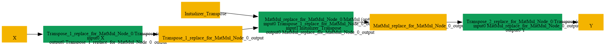
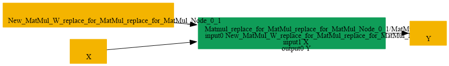

# Replace_MatMul_InitializerAt1_By_InitializerAt0

## Introduction

### Description

Optimize Transpose->MatMul->Transpose Pattern by Composing into

```text
a Direct MatMul with Transposed Initializer
```

This transformation pattern detects and optimizes a sequence of operations: Transpose(X) -> MatMul(W_init, Transpose(X)) -> Transpose(result), where W_init is an initializer in the second input position. The goal is to eliminate redundant transpose operations while maintaining numerical equivalence, reducing memory bandwidth, improving cache locality, and enabling faster inference by collapsing multiple operations into one.

### Mathematical Equivalence

The transformation exploits the property that successive transposes can be composed with the initializer weight tensor:

```text
Transpose(MatMul(W^T, Transpose(X))) = MatMul(W, X)
```

When an initializer appears as the second operand of a MatMul that is wrapped by Transpose operations on both input and output, we can compose the transposes into a single transformed initializer and eliminate the runtime transpose operations entirely.

### Transformation Steps

1. Identify a Transpose node on the input X.
2. Check if the next operation is a MatMul with the transposed input and
```text
an initializer W_init as the second input.
```

3. Verify that a final Transpose node is applied to the MatMul output.
4. Create a new initializer W_init_transposed by applying the transpose
```text
operation to the original initializer.
```

5. Replace the entire Transpose->MatMul->Transpose sequence with a single
```text
MatMul operation using W_init_transposed as the first input and the
original X as the second input.
```

6. Remove the three original nodes (initial Transpose, MatMul, and final
```text
Transpose) and the original initializer from the graph.
```

### Benefits

- Eliminates redundant transpose operations, reducing runtime overhead.
- Decreases memory bandwidth by avoiding intermediate tensor transposes.
- Improves cache locality by reducing the number of memory access patterns.
- Enables fusion with subsequent operations that can accept the composed
```text
MatMul directly.
```

- Reduces graph complexity and makes the computation easier for backends
```text
to optimize and schedule efficiently.
```

- Positions the initializer as the first operand of a direct MatMul,
```text
compatible with weight-on-left inference patterns.
```

### Preconditions

- The pattern must match exactly: Transpose(X) -> MatMul(W_init, result)
```text
-> Transpose(output).
```

- The second input of MatMul must be a constant initializer.
- Both Transpose operations must swap the last two dimensions.
- The shapes must be compatible through the entire sequence.
### Example

Batch Matrix Multiplication Optimization Original computation (with redundant transposes):

```text
Input X: [B, M, K]
Weight W_init (Initializer): [K, N]
Step 1:  X_T = Transpose(X) -> [B, K, M]
Step 2:  Y_T = MatMul(W_init, X_T) -> [B, N, M]
Step 3:  Y = Transpose(Y_T) -> [B, M, N]
Output Y: [B, M, N]
```

After optimization (direct MatMul with composed initializer):

```text
Input X: [B, M, K]
Weight W_init_T (new Initializer): Transpose(W_init) -> [N, K]
Direct:  Y = MatMul(W_init_T, X) -> [B, M, N]
Output Y: [B, M, N]
```

Both computations produce identical numerical results. The optimized form eliminates three operations (two Transposes and one MatMul instruction) and replaces them with a single MatMul, significantly improving efficiency.

## SearchBy



## ReplaceBy


