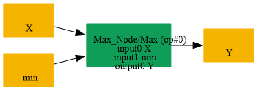
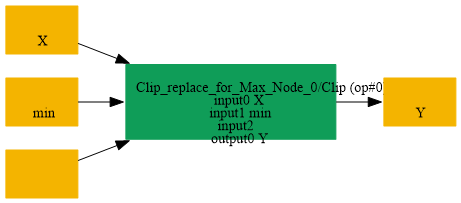

# Replace_Max_By_Clip_NoneMax

## Introduction

### Description

Replace Max with a Clip operation without a maximum value

This transformation restores the Clip form of a lower-bound-only clipping operation. A Max node compares the input with a minimum value, which is equivalent to Clip with an omitted maximum input.

### Match Condition

- The node operator is Max
- The first input is the data tensor
- The second input is the minimum value
### Mathematical Equivalence

Max(x, min) = Clip(x, min, None)

### Transformation Steps

1. Find a Max node with data and minimum inputs
2. Create a Clip node using the same data input
3. Use the Max second input as the Clip minimum input
4. Leave the Clip maximum input empty
5. Reuse the original Max output name
6. Remove the original Max node
### Example

**Original graph:** Max(input, min_value) input = [-2.0, 0.5, 4.0] and min_value = 1.0 **Original output:** Max([-2.0, 0.5, 4.0], 1.0) = [1.0, 1.0, 4.0] **Restored graph:** Clip(input, 1.0, None) **Restored output:** Clip([-2.0, 0.5, 4.0], 1.0, None) = [1.0, 1.0, 4.0]

### Result

Equivalent Clip node replaces the lower-bound Max operation

## SearchBy

## ReplaceBy

