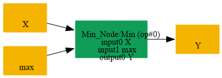
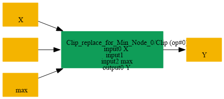

# Replace_Min_By_Clip_NoneMin

## Introduction

### Description

Replace Min with a Clip operation without a minimum value

This transformation restores the Clip form of an upper-bound-only clipping operation. A Min node compares the input with a maximum value, which is equivalent to Clip with an omitted minimum input.

### Match Condition

- The node operator is Min
- The first input is the data tensor
- The second input is the maximum value
### Mathematical Equivalence

Min(x, max) = Clip(x, None, max)

### Transformation Steps

1. Find a Min node with data and maximum inputs
2. Create a Clip node using the same data input
3. Leave the Clip minimum input empty
4. Use the Min second input as the Clip maximum input
5. Reuse the original Min output name
6. Remove the original Min node
### Example

**Original graph:** Min(input, max_value) input = [-2.0, 0.5, 4.0] and max_value = 1.5 **Original output:** Min([-2.0, 0.5, 4.0], 1.5) = [-2.0, 0.5, 1.5] **Restored graph:** Clip(input, None, 1.5) **Restored output:** Clip([-2.0, 0.5, 4.0], None, 1.5) = [-2.0, 0.5, 1.5]

### Result

Equivalent Clip node replaces the upper-bound Min operation

## SearchBy

## ReplaceBy

