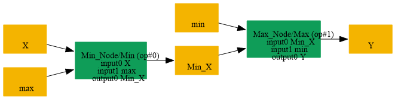
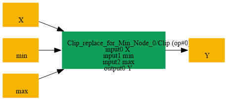

# Replace_Min_Max_By_Clip

## Introduction

### Description

Replace Min followed by Max with a Clip operation

This transformation recognizes the decomposition of Clip into a Min operation followed by a Max operation. It restores the original Clip node while preserving the final output name.

### Match Condition

- The first node is Min(data, max)
- The second node is Max(min_result, min)
- The Max data input is connected to the Min output
- The decomposition uses the same bound order as Clip(data, min, max)
### Mathematical Equivalence

Max(Min(x, max), min) = Clip(x, min, max) The bounds must satisfy min <= max for the usual clipping behavior.

### Transformation Steps

1. Find a Min node that limits the data input by the maximum value
2. Find a Max node that consumes the Min output
3. Create a Clip node with inputs data, minimum, and maximum
4. Connect the Clip output to the original Max output
5. Remove the original Min and Max nodes
### Example

**Decomposed graph:** Max(Min(input, max_value), min_value) input = [-2.0, 0.5, 4.0], min_value = 0.0, max_value = 1.5

```text
1. Min(input, 1.5) = [-2.0, 0.5, 1.5]
2. Max([-2.0, 0.5, 1.5], 0.0) = [0.0, 0.5, 1.5]
```

**Restored graph:** Clip(input, 0.0, 1.5) **Restored output:** Clip([-2.0, 0.5, 4.0], 0.0, 1.5) = [0.0, 0.5, 1.5]

### Result

Equivalent Clip node replaces the Min + Max decomposition

## SearchBy



## ReplaceBy


