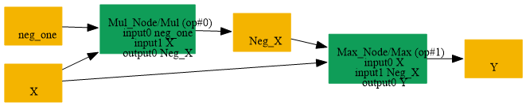

# Replace_Mul_Max_By_Abs

## Introduction

### Description

Replace Max and Mul decomposition with Abs operation

This transformation pattern searches for an Abs decomposition implemented as a Max node comparing the original input and its negation from a Mul and replaces it with a single Abs operation.

### Mathematical Equivalence

Abs(x) = Max(x, -x)

### Transformation Steps

1. Detect a Max node whose second input comes from Mul(x, -1)
2. Create an Abs node using the original input
3. Remove the Mul and Max nodes
4. Remove the associated constant initializer if present
### Benefits

- Simplifies the graph by restoring the original Abs operation
- Reduces node count and improves readability
- Avoids unnecessary decomposition when Abs is supported
### Preconditions

- The Max node must compare the original input with its negation
- The negation must be generated by a Mul node with a scalar -1 initializer
### Example

**Input:** x = [1.0, -2.0, 0.5] Decomposed computation:

```text
Mul: neg_x = x * -1 = [-1.0, 2.0, -0.5]
Max: output = Max(x, neg_x) = [1.0, 2.0, 0.5]
```

Restored Abs computation:

```text
Abs(x) = [1.0, 2.0, 0.5]
```

### Result

Equivalent Abs node replaces the Max + Mul decomposition

## SearchBy



## ReplaceBy


