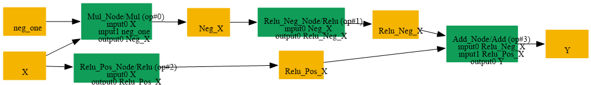

# Replace_Mul_Relu_Add_By_Abs

## Introduction

### Description

Replace Mul + Relu + Add decomposition with Abs operation

This transformation pattern searches for an Abs decomposition implemented as a Mul, two Relu operations, and an Add, then replaces it with a single Abs operation.

### Mathematical Equivalence

Abs(x) = Relu(x) + Relu(-x)

### Transformation Steps

1. Detect an Add node that sums the outputs of two Relu nodes
2. Detect one Relu input coming from a Mul(x, -1)
3. Create an Abs node using the original input
4. Remove the Mul, the two Relu nodes, the Add node, and the scalar initializer
### Benefits

- Simplifies the graph by restoring the original Abs operation
- Reduces node count and improves readability
- Avoids unnecessary decomposition when Abs is supported
### Preconditions

- The Add node must combine Relu(x) and Relu(-x)
- The negation must be generated by a Mul node with a scalar -1 initializer
### Example

**Input:** x = [1.0, -2.0, 0.5] Decomposed computation:

```text
Mul:        neg_x = x * -1 = [-1.0, 2.0, -0.5]
Relu(neg_x)= [0.0, 2.0, 0.0]
Relu(x):    [1.0, 0.0, 0.5]
Add:        output = [1.0, 2.0, 0.5]
```

Restored Abs computation:

```text
Abs(x) = [1.0, 2.0, 0.5]
```

### Result

Equivalent Abs node replaces the Mul + Relu + Add decomposition

## SearchBy



## ReplaceBy


