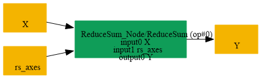
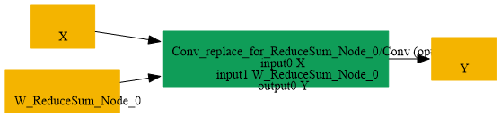

# Replace_ReduceSum_Axis1_By_Conv

## Introduction

### Description

Replace ReduceSum axis=1 by Conv operation

This transformation pattern converts a ReduceSum node that reduces the channel axis (axis=1) into an equivalent Conv operation. It is useful when a graph needs to be expressed with convolution primitives while preserving the same reduction semantics.

### Mathematical Equivalence

ReduceSum(X, axes=[1], keepdims=1) = Conv(X, W, b=0) where W is a 1x1 kernel with ones across the input channels and the output channel is 1. For an input tensor X with shape [N, C, H, W], the convolution output is Y[n, 0, h, w] = sum_c X[n, c, h, w], which matches the ReduceSum along axis 1 while keeping the spatial dimensions unchanged.

### Transformation Steps

1. Detect a ReduceSum node whose reduction axis is 1 and keeps the dimension.
2. Create a Conv weight tensor W with shape [1, C, 1, 1].
3. Fill W with ones so each output element sums all input channels.
4. Replace the ReduceSum node with a Conv node using W and zero bias.
5. Remove the original ReduceSum node.
### Benefits

- Re-expresses channel reduction using a standard Conv primitive.
- Preserves the original output shape and numerical reduction semantics.
- Improves compatibility with backends that prefer Conv-based forms.
### Preconditions

- The ReduceSum node must reduce axis 1 (channel axis).
- The output must preserve the reduced dimension using keepdims=1.
- The target input must be a tensor compatible with Conv semantics.
### Example

**Input tensor:** X with shape [N, C, H, W] ReduceSum computation:

```text
Y = ReduceSum(X, axes=[1], keepdims=1)
```

Equivalent Conv form:

```text
W = ones([1, C, 1, 1])
Y = Conv(X, W, b=0)
```

where each output channel sums all input channels at each spatial location.

### Result

A Conv-based replacement that preserves the ReduceSum axis=1 semantics

## SearchBy



## ReplaceBy


