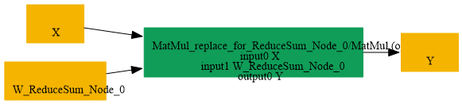

# Replace_ReduceSum_LastAxis_By_MatMul

## Introduction

### Description

Replace ReduceSum over the last axis by MatMul operation

This transformation pattern rewrites a ReduceSum node that collapses the final tensor axis into an equivalent MatMul operation. It is useful when a backend or optimization pass prefers a matrix multiplication form for the same computation.

### Mathematical Equivalence

For an input tensor X with shape [..., C] and keepdims=1, ReduceSum(X, axes=[-1], keepdims=1) is equivalent to MatMul(X, W) where W is a column vector of ones with shape [C, 1]. Each output element equals the sum of the values along the last axis, matching the original reduction semantics.

### Transformation Steps

1. Detect a ReduceSum node that reduces the final axis with keepdims enabled.
2. Build a constant weight matrix W of shape [C, 1] filled with ones.
3. Replace the reduction with a MatMul between X and W.
4. Remove the original ReduceSum axes initializer and node.
### Benefits

- Re-expresses a reduction as a standard MatMul primitive.
- Preserves the reduced output shape when keepdims=1.
- Enables graph fusion or backend compatibility for matrix-multiplication-centric
```text
optimization pipelines.
```

### Preconditions

- The ReduceSum node must reduce the last axis (axis=-1 or the last index).
- The output must preserve the reduced axis using keepdims=1.
- The input tensor must be compatible with standard ONNX MatMul semantics.
### Example

**Input tensor:** X with shape [N, C] ReduceSum computation:

```text
Y = ReduceSum(X, axes=[-1], keepdims=1)
```

Equivalent MatMul form:

```text
W = ones([C, 1])
Y = MatMul(X, W)
```

where each output row equals the sum of the corresponding input row.

### Result

A MatMul-based replacement that preserves the ReduceSum last-axis semantics

## SearchBy


## ReplaceBy


