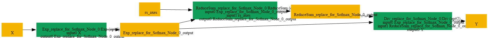

# Replace_Softmax_By_Exp_RS_Div

## Introduction

### Description

Replace Softmax with Exp + ReduceSum + Div Operations

This transformation pattern replaces a Softmax operation with an equivalent **computation using three basic operations:** Exp, ReduceSum, and Div.

### Mathematical Equivalence

Softmax(x, axis=k) = Exp(x) / ReduceSum(Exp(x), axis=k)

### Transformation Steps

1. Extract the axis attribute from the original Softmax node
2. Create an Exp operation on the input
3. Apply ReduceSum on the Exp output along the specified axis
4. Divide the Exp output by the ReduceSum result using Div
5. Remove the original Softmax node
### Benefits

- Enables optimization and fusion with other operations
- Allows backend-specific implementations of Exp, ReduceSum, and Div
- Supports decomposition for hardware with limited Softmax support
- Maintains numerical equivalence with the original Softmax
### Preconditions

- Input tensor must have the required shape for Softmax computation
- Axis attribute must be properly specified in the Softmax node
### Example

**Input:** x = [1.0, 2.0, 3.0], axis=0 Original Softmax computation:

```text
Softmax(x) = [e^1, e^2, e^3] / (e^1 + e^2 + e^3)
= [2.718, 7.389, 20.086] / 30.193
= [0.0900, 0.2447, 0.6652]
```

Decomposed computation:

```text
1. Exp:        exp_result = [e^1, e^2, e^3] = [2.718, 7.389, 20.086]
2. ReduceSum:  sum_result = 30.193
3. Div:        output = [2.718, 7.389, 20.086] / 30.193
= [0.0900, 0.2447, 0.6652]  ✓ Same result
```

### Result

Equivalent computation using atomic operations instead of Softmax

## SearchBy


## ReplaceBy


