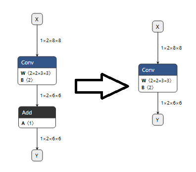

# ONMAModifyModel.py

## Purpose

The command-line utility that applies a JSON-defined modification pattern to an input ONNX model,
saves the modified model, and checks whether the original and modified models produce equivalent outputs.

Summary of the process:
1. Reads --input, --output, and --modify arguments.
2. Loads the JSON pattern and applies it through ONMAModel.
3. Opens both ONNX files with ONNX Runtime.
4. Generates random inputs, runs inference on both models, and compares their outputs with numpy.allclose.
5. Prints Result: Equivalent only when outputs match and the model files differ; otherwise, prints Result: NOT Equivalent.

Defined JSON pattern structure:
- User can define modifications in a JSON file, specifying operations to add, remove, or change nodes and parameters in the ONNX model.
- Or use the sample JSON pattern provided in Sample/ModifyNetwork.

## Usage

```text
python Tools/ONMAModifyModel.py --input yolop-640-640.onnx --output yolop-640-640_modify.onnx --modify Sample/Modify_Sample.json
```

## Command-line arguments

| Option | Description | Default |
| --- | --- | --- |
| --modify, -md | Setting to modify network | `` |
| --input, -in | Input ONNX file path | `None` |
| --output, -ot | Output ONNX file path | `None` |

## Images



## References

- [`Sample/Modify_Sample.json`](../../Sample/Modify_Sample.json)
- [`Sample/ModifyNetwork/Optimizations/Fuse_Add_Scalar_Into_Conv.json`](../../Sample/ModifyNetwork/Optimizations/Fuse_Add_Scalar_Into_Conv.json)
- [`Sample/ModifyNetwork/Transformations/Compose/Replace_MatMul_By_ReduceSum_LastAxis.json`](../../Sample/ModifyNetwork/Transformations/Compose/Replace_MatMul_By_ReduceSum_LastAxis.json)
